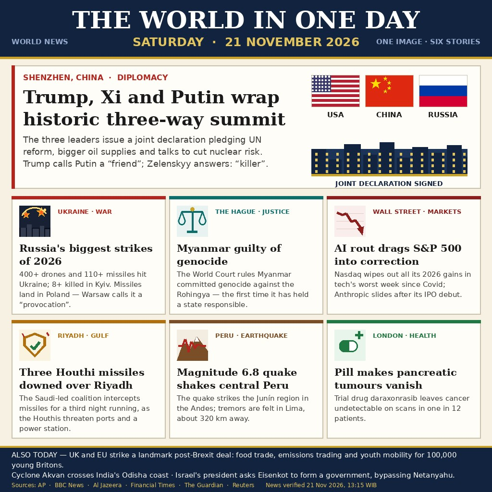

# news-image-20261121 — The World in One Day

[](https://make.fun/c/news-image-20261121)
[](https://make.fun/c/news-image-20261121)
[](https://make.fun/c/news-image-20261121)

Entry for the [make.fun](https://make.fun/c/news-image-20261121) bounty
**"Sum up 21 November's world news in one image"** — pool $100, deadline
23 Nov 2026 07:00 WIB.



## What it is

A one-page newspaper front page, drawn deterministically by
[`build_image.py`](build_image.py) (Pillow, fixed layout, no randomness, no
network): a masthead naming the day, a lead story on the Shenzhen trilateral
summit, six illustrated story cards across regions and beats, and a footer
strip with two more stories plus sources.

[`main.py`](main.py) is the competition program: standard library only, it
copies the pre-built `entry.png` to `$MAKEFUN_OUTPUT_DIR/entry.png`, so both
grader runs write byte-identical output.

## Stories covered (verified 21 Nov 2026, ~13:15 WIB)

| # | Story | Sources |
|---|-------|---------|
| 1 | **Lead — Trump, Xi and Putin wrap historic three-way summit in Shenzhen.** Joint declaration pledges UN reform, bigger oil supplies and talks to cut nuclear risk. Trump calls Putin a "friend"; Zelenskyy answers: "killer". | AP, BBC News |
| 2 | **Russia's biggest strikes of 2026 on Ukraine** — 400+ drones, 110+ missiles; 8+ killed in Kyiv. Missiles land in Poland; Warsaw calls it a "provocation". | AP, BBC News, Reuters |
| 3 | **ICJ finds Myanmar committed genocide against the Rohingya** — the first time the World Court has held a state responsible. | AP, Reuters |
| 4 | **AI stock rout: S&P 500 and Dow into correction.** Nasdaq wipes out all its 2026 gains in tech's worst week since Covid; Anthropic slides after its IPO debut. | Financial Times, The Guardian, BBC News |
| 5 | **Saudi-led coalition intercepts three Houthi missiles aimed at Riyadh**, third night running; Houthis threaten ports and a power station. | Al Jazeera |
| 6 | **Magnitude 6.8 earthquake strikes central Peru** (Junín); tremors felt in Lima, ~320 km away. | Peru Geophysical Institute, via The Daily Short |
| 7 | **Trial pill daraxonrasib leaves pancreatic cancer undetectable** on scans in one in 12 patients. | OneTurn News day report |
| 8 | **UK–EU landmark post-Brexit deal**: food trade, emissions trading and youth mobility for 100,000 young Britons. | BBC News, The Guardian |
| 9 | **Cyclone Akvan crosses India's Odisha coast** near Gopalpur. | CareerIndia news bulletin |
| 10 | **Israel's president asks Eisenkot to form a government**, bypassing Netanyahu. | The Paris Eye |

## Verification

```sh
# rebuild the image twice and compare hashes (deterministic)
python3 build_image.py entry.png
python3 build_image.py /tmp/entry-check.png
sha256sum entry.png /tmp/entry-check.png   # identical

# run the entry program twice like the grader
mkdir -p out1 out2
MAKEFUN_OUTPUT_DIR=out1 python3 main.py
MAKEFUN_OUTPUT_DIR=out2 python3 main.py
cmp out1/entry.png out2/entry.png          # identical
```

Gate checks: 1024×1024 px, JPEG bytes in `entry.png`, ~255 KB (limit 1 MiB).

## License

MIT — see [LICENSE](LICENSE).
